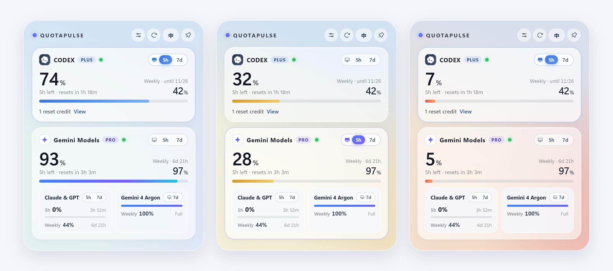
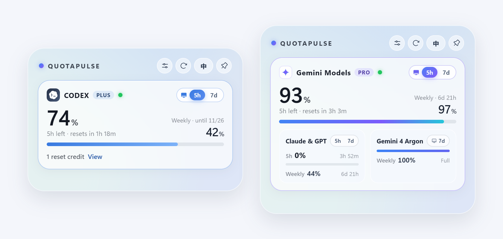
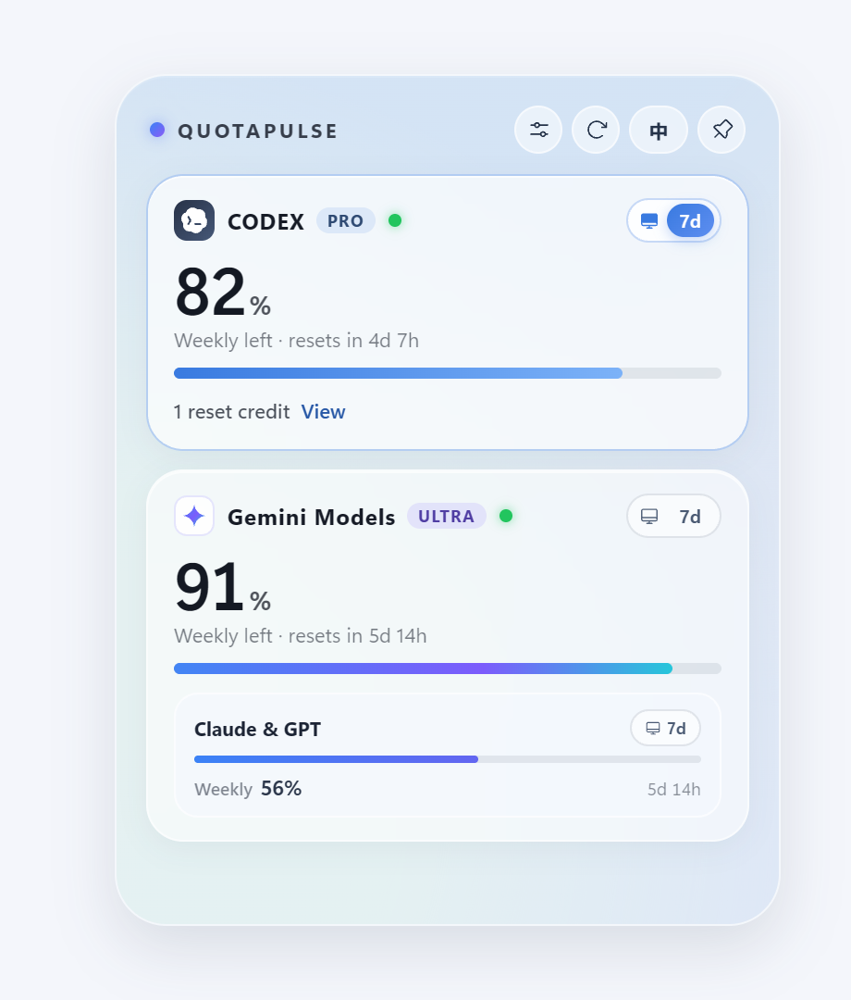
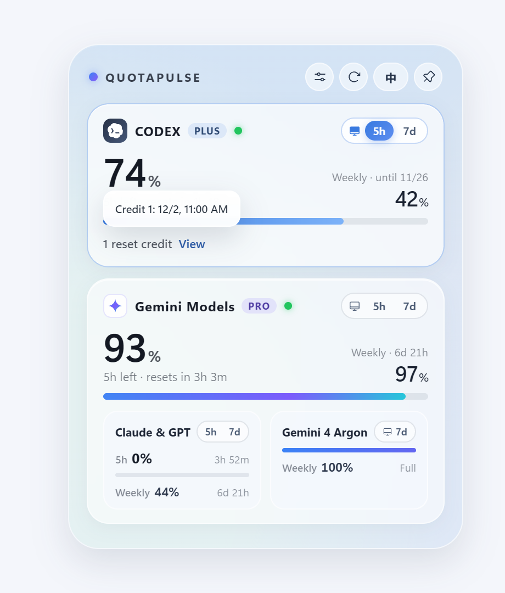
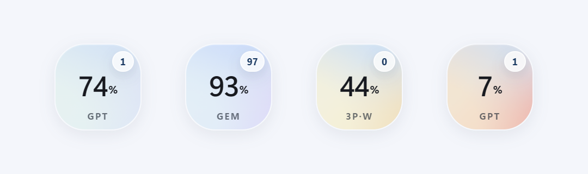

<div align="center">


# QuotaPulse

Windows-only system tray monitor and floating desktop widget for **Codex (GPT)** and **Antigravity (Gemini Models, Claude & GPT, Gemini 4 Argon)** — use **either service independently** or monitor **both together** at a glance.

[](https://github.com/ChengruWu/QuotaPulse/releases/latest)
[](https://github.com/ChengruWu/QuotaPulse/releases/latest)
[](#development--release)
[](LICENSE)

**English** · [简体中文](README.zh-CN.md)

<br />



</div>

---

## Highlights

- **Use Codex only, Antigravity only, or both together**: Neither service is required to use the other. Toggle either anytime via the topbar slider menu or tray **Services / 显示服务** submenu—the popup automatically compacts to match (`360 × 240` for Codex-only, `360 × 250`–`316` for Antigravity-only, or `360 × 460` for dual-service), pauses background polling for hidden providers, and never shows missing-login warnings for services you don't use.
- **All-in-one tier & multi-pool coverage**: Independently reads local **Codex Desktop (GPT)** and **Antigravity** (`Gemini Models` 5h/weekly, `Claude & GPT` 5h/weekly, and `Gemini 4 Argon` weekly) quotas with full fault isolation. Dual-window plans (such as **Codex Plus** and **Gemini Pro**) show both 5h and Weekly windows, while weekly-only tiers (such as **Codex Pro**, **Gemini Ultra**, and **Gemini 4 Argon**) automatically adapt to a clean Weekly-only layout.
- **7 selectable taskbar quota sources (5h & Weekly)**: Displays the live remaining percentage directly on the Windows system tray icon (`32 × 32`, with provider-tinted gradients, health-colored borders, and a two-line multi-pool tooltip). Switch anytime between **Codex (GPT)** (`5h` / `Weekly`), **Gemini** (`5h` / `Weekly`), **Claude & GPT** (`5h` / `Weekly`), and **Gemini 4 Argon** (`Weekly`) from the card pills or tray right-click menu.
- **Multi-source draggable floating orb (`100 × 100`)**: Toggle **Floating widget / 桌面悬浮窗** from the tray menu to float a translucent draggable orb that tracks your active tray quota source (`GPT`, `GPT·W`, `GEM`, `GEM·W`, `3P`, `3P·W`, `ARGON`), shows a corner badge (Codex reset credits or secondary window), expands smoothly on hover while anchoring to screen edges, and supports always-on-top and click-through lock.
- **Honest health & status indicators**: Healthy (`>= 50%`), caution (`10%–49%`), and critical (`< 10%`) color themes, plus clear stale, signed-out (with one-click **Open Antigravity**), and unavailable states—never fabricates or estimates percentages.
- **Built-in bilingual UI & signed auto-updates**: One-click Chinese (`zh-CN`) / English (`en`) switch inside the overview card or tray menu, atomic preference persistence (`.json.bak` backup), and signed Windows NSIS auto-updates checked on startup and every 6 hours.

## Interface Preview

### Independent Single-Service Mode (GPT Only / Gemini Only)

<div align="center">

</div>

Don't use both services? Hide either one anytime via the topbar slider popover or the tray **Services / 显示服务** submenu. The popup automatically compacts to match the active service (`360 × 240` for **Codex / GPT only**, `360 × 316` for **Antigravity / Gemini only** with sub-pools, or `360 × 250` without sub-pools) and pauses background polling for the hidden provider.

| Weekly-Only Tiers (`Codex Pro` & `Gemini Ultra`) | Codex Reset Credits & Expiration Details |
| :---: | :---: |
|  |  |
| Weekly-only subscriptions automatically promote the weekly window to the primary view, hide unavailable `5h` pills, and track weekly quotas cleanly (`GPT·W` / `GEM·W` / `3P·W`). | Read-only display of available Codex reset credits and exact expiration timestamps in a lightweight popover. |

### Multi-Source Floating Orb (`100 × 100`)

<div align="center">

</div>

Tracks your active tray source (`GPT`, `GPT·W`, `GEM`, `GEM·W`, `3P`, `3P·W`, `ARGON`), shows a corner badge (reset credits or secondary window), and expands smoothly on hover.

### Health State Legend

| State | Condition | Visual Cue |
| --- | --- | --- |
| **Healthy** | `>= 50%` remaining | Cool blue-mint aurora glow & blue progress bar |
| **Caution** | `10%–49%` remaining | Warm amber-gold aurora glow & amber progress bar |
| **Critical** | `< 10%` remaining | Coral-orange aurora glow & red-orange progress bar |
| **Stale / Signed out / Unavailable** | Refresh failed, expired (> 30 min), or local login missing | Honest inline status card with quick refresh & **Open Antigravity** action |

## How It Works

QuotaPulse reads existing local login states on your Windows PC and sends read-only HTTPS quota requests:

| Provider | Local Source | Polling Cadence | Behavior & Fallback |
| --- | --- | --- | --- |
| **Codex (GPT)** | `%CODEX_HOME%\auth.json` or `%USERPROFILE%\.codex\auth.json` | Every **10s** | Read-only HTTPS requests to ChatGPT usage & reset-credits endpoints. |
| **Antigravity** (`Gemini Models`, `Claude & GPT`, `Gemini 4 Argon`) | Prefers silent local official CLI `agy.exe --log-file %TEMP%\quotapulse-agy-poll.log --output-format json --print-timeout 15s -p "/usage"` with `AGY_CLI_DISABLE_AUTO_UPDATE=true` (zero model token consumption) | Every **60s** (or immediately on manual refresh) | Auto-detected in `%USERPROFILE%\.gemini\bin\agy.exe`, standard Antigravity install folders, `PATH`, or `ANTIGRAVITY_CLI_PATH`. Falls back to strictly read-only (`SQLITE_OPEN_READ_ONLY`) reads of `%APPDATA%\Antigravity\User\globalStorage\state.vscdb` (or `Antigravity IDE` / `%USERPROFILE%\.gemini\oauth_creds.json`, customizable via `ANTIGRAVITY_AUTH_PATH`). |

> Browser preview (`npm run dev`) uses mock dual-service data. Real quota reading requires the Windows Tauri desktop app and active local logins.

## Windows Tray & Controls

QuotaPulse starts hidden in the Windows system tray:

- **Left-click tray icon**: Opens or hides the taskbar-anchored overview card (click again or click outside to dismiss).
- **Right-click tray icon**:
  - **Floating widget / 桌面悬浮窗** — Show or hide the draggable `100 × 100` floating orb.
  - **Refresh now / 立即刷新** — Trigger an immediate parallel refresh of enabled services.
  - **Services / 显示服务** — Toggle **Codex (GPT)** and **Antigravity (Gemini)** independently (at least one remains active).
  - **Tray display / 托盘显示额度** — Switch the taskbar icon between available `5h` and `Weekly` quota pools.
  - **Check for updates / 检查更新**, **Unlock widget / 解锁穿透**, **Switch Language / 切换语言**, **Start at login / 开机自启**, **Quit / 退出**.

> **Taskbar visibility tip**: Windows controls which third-party icons stay visible. If QuotaPulse only appears inside the overflow chevron (`^`), open **Settings → Personalization → Taskbar → Other system tray icons** and turn on **QuotaPulse**.

## Download & Upgrade (Windows)

Download the latest Windows build from GitHub Releases:

- **Latest release**: https://github.com/ChengruWu/QuotaPulse/releases/latest
- **Recommended installers**:
  - NSIS installer: `QuotaPulse_0.2.0_x64-setup.exe` (default for automatic updates)
  - MSI package: `QuotaPulse_0.2.0_x64_en-US.msi`
- **Upgrading from Quota Float v0.1.7**: QuotaPulse preserves the `app.quotafloat.desktop` identifier, `%APPDATA%\app.quotafloat.desktop\preferences.json`, and updater channel so existing settings and automatic updates carry over cleanly.

> **SmartScreen note**: Release installers are not signed with a Windows Authenticode certificate and may trigger Windows SmartScreen warnings on first launch. Tauri auto-updater packages include cryptographic update signatures (`.sig` / `latest.json`) to verify update integrity.

## Privacy & Security

QuotaPulse is local-first and read-only:

- Reads local Codex and Antigravity login states only to fetch usage windows.
- Sends Codex requests only to ChatGPT quota endpoints and Antigravity requests only to Google Cloud Code quota endpoints (or through local `agy.exe`).
- Stores only UI preferences (`preferences.json` and `.json.bak`) in `%APPDATA%\app.quotafloat.desktop\`.
- Never copies or persists tokens, account IDs, prompts, chat history, raw quota responses, or local auth paths.
- Contains zero telemetry, analytics, crash reporting, or third-party tracking.

See [PRIVACY.md](PRIVACY.md), [SECURITY.md](SECURITY.md), and [docs/KNOWN-LIMITATIONS.md](docs/KNOWN-LIMITATIONS.md) for full details.

## Development & Release

### Requirements

- **OS**: Windows 10 / 11 (x64)
- **Node.js**: 20+
- **Rust**: Stable MSVC toolchain + Microsoft C++ Build Tools

### Local Commands

```powershell
npm install
npm run dev
npm test
cargo test --manifest-path src-tauri/Cargo.toml
npm run build
npm run tauri dev
```

### CI & Release

GitHub Actions workflows are configured exclusively for Windows builds:

- **CI** on push / PR: runs frontend tests (`npm test`), Rust tests (`cargo test`), web build (`npm run build`), dependency audit, and Windows Tauri bundle verification.
- **`v*` tags**: builds signed Windows updater artifacts (`NSIS`, `MSI`, `.sig`, `latest.json`) and uploads them to a draft GitHub Release.

See [CONTRIBUTING.md](CONTRIBUTING.md) for contribution guidelines.

## Acknowledgements

QuotaPulse originally started as a fork of [change-42-yhmm/quota-float](https://github.com/change-42-yhmm/quota-float) (MIT License), and has since evolved independently into a Windows-only multi-service monitor for Codex (GPT) and Antigravity (Gemini, Claude & GPT, Gemini 4 Argon). Many thanks to the original author and contributors for the foundational architecture and visual direction.

## Feedback & License

- **Feedback**: Open bugs, compatibility reports, or feature requests on [GitHub Issues](https://github.com/ChengruWu/QuotaPulse/issues) (please redact tokens, account IDs, raw logs, and personal paths).
- **License**: [MIT](LICENSE)
