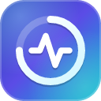
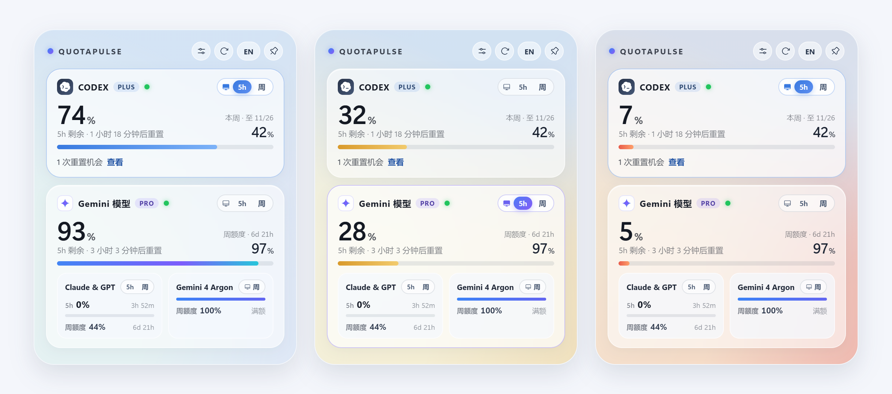
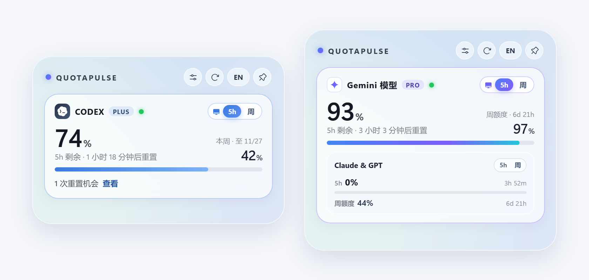
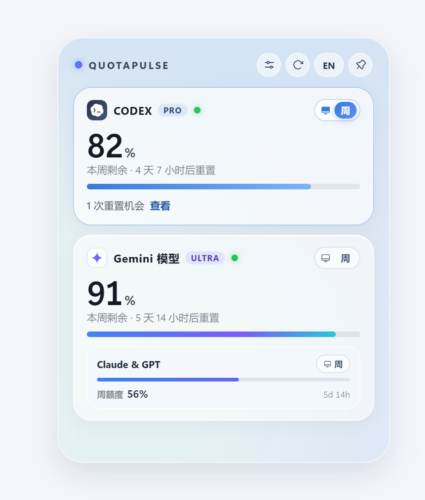
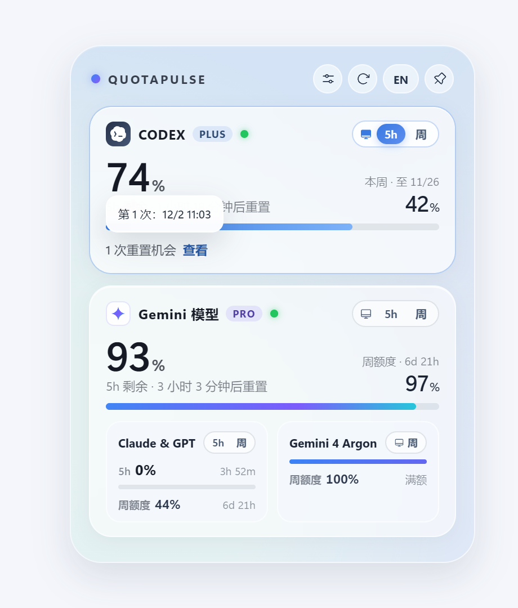
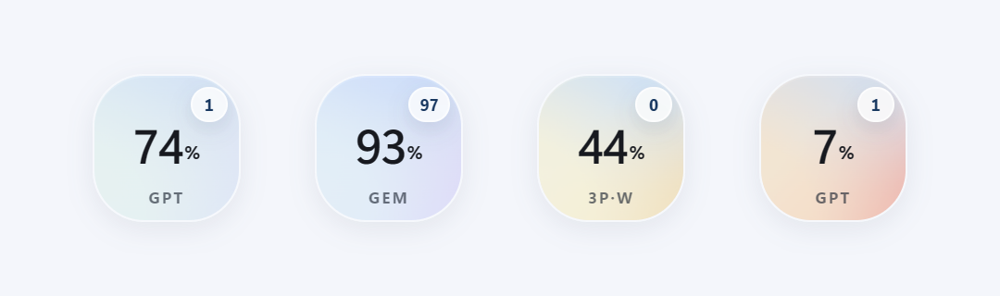
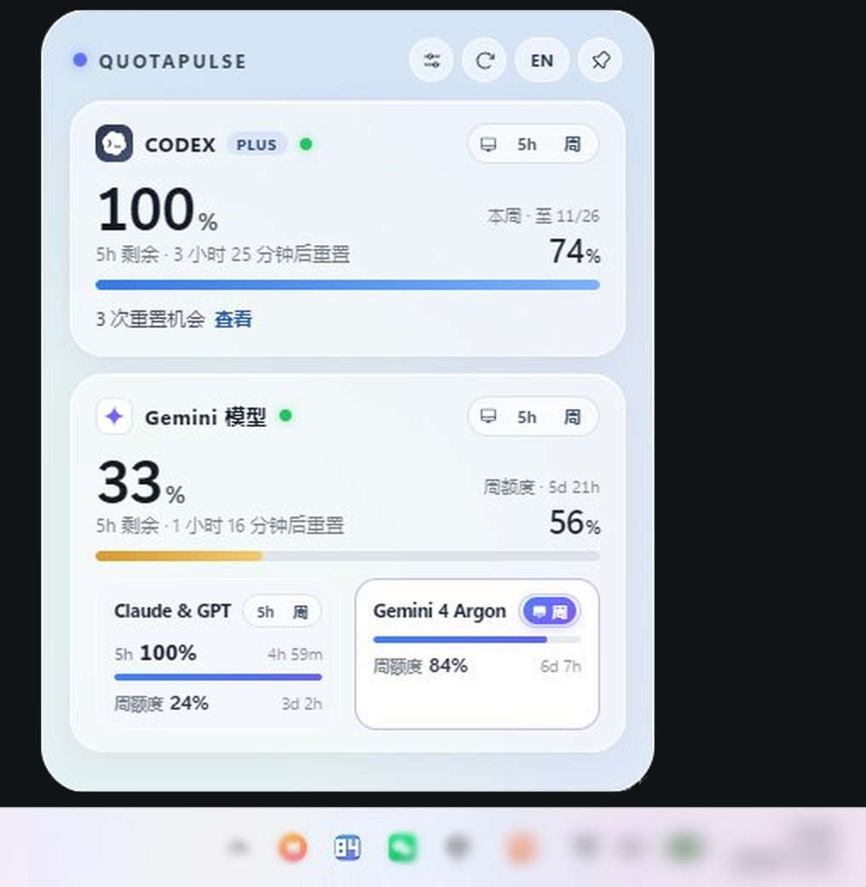
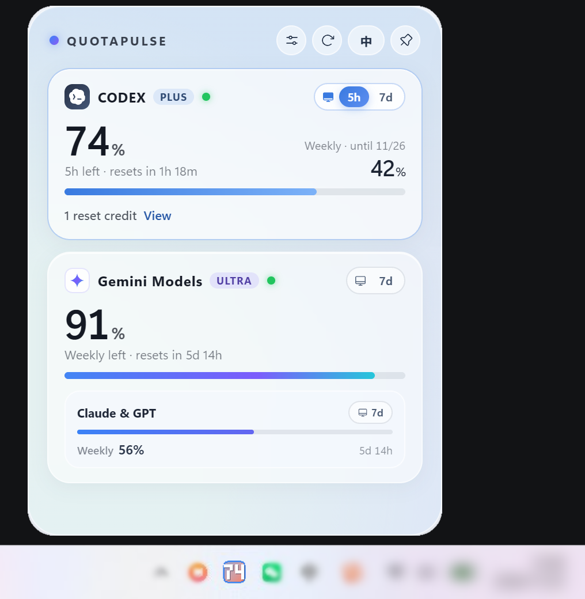

<div align="center">



# QuotaPulse

专为 **Windows** 打造的轻量系统托盘与桌面悬浮窗监控工具，支持 **Codex (GPT)** 与 **Antigravity（Gemini Models、Claude & GPT、Gemini 4 Argon）** 额度查看 —— **可单独只用其中一个，也可双服务同屏查看**。

[](https://github.com/ChengruWu/QuotaPulse/releases/latest)
[](https://github.com/ChengruWu/QuotaPulse/releases/latest)
[](#本地开发与发布)
[](LICENSE)

[English](README.md) · **简体中文**

<br />



</div>

---

## 核心特性

- **支持单独使用 Codex 或 Antigravity，也支持双服务同屏**：无需同时安装或登录两个工具。随时在面板顶栏设置或托盘 **Services / 显示服务** 子菜单中独立开关任一服务——仅开启单服务时弹窗自动收窄（仅 GPT 为 `360 × 240`，仅 Gemini 为 `360 × 250`–`316`，双服务为 `360 × 460`），停止隐藏服务的后台轮询，且不会对未启用的服务报未登录提示。
- **多服务与多档位套餐全面适配**：独立读取本机 **Codex Desktop (GPT)** 与 **Antigravity**（`Gemini Models` 5 小时 / 周额度、`Claude & GPT` 5 小时 / 周额度、`Gemini 4 Argon` 周额度）数据，两套数据源故障完全隔离。对于同时包含 5 小时与周额度的订阅（如 **Codex Plus**、**Gemini Pro**），完整展示双周期窗口；对于纯周额度套餐（如 **Codex Pro**、**Gemini Ultra** 与 **Gemini 4 Argon**），自动切换为纯周额度精简布局。
- **7 路任务栏托盘额度自由切换（5h / 周额度）**：在 Windows 系统托盘图标（`32 × 32`）上实时绘制剩余百分比，提供差异化渐变底色、健康色边框与双行多池速览 Tooltip。可在卡片分段按钮或托盘右键菜单中随时切换 **Codex (GPT)**（5h / 周额度）、**Gemini**（5h / 周额度）、**Claude & GPT**（5h / 周额度）与 **Gemini 4 Argon**（周额度）。
- **多源可拖拽桌面悬浮球（`100 × 100`）**：在托盘右键菜单开启 **Floating widget / 桌面悬浮窗**，即可显示半透明悬浮球，实时跟随当前所选托盘源并标注服务/周期标签（`GPT`、`GPT·W`、`GEM`、`GEM·W`、`3P`、`3P·W`、`ARGON`），右上角徽章展示 Codex 重置机会数或次要窗口额度；悬停平滑贴边展开详情，支持置顶与鼠标穿透锁定。
- **诚实的状态与健康分级**：以健康（`>= 50%`）、预警（`10%–49%`）、告急（`< 10%`）三套极光配色直观区分余量；遇到过期（stale）、未登录（支持一键 **打开 Antigravity**）或接口不可用时如实提示，绝不伪造或估算数值。
- **内置中英双语切换与签名自动更新**：卡片顶栏与托盘菜单均支持一键切换简体中文（`zh-CN`）/ 英文（`en`），偏好配置带 `.json.bak` 原子备份持久化，启动及每 6 小时自动检查带签名校验的 Windows NSIS 更新。

## 界面预览

### 独立单服务模式（仅显示 GPT / 仅显示 Gemini）

<div align="center">

</div>

不需要同时使用两个服务？通过面板右上角设置图标或托盘右键 **Services / 显示服务** 子菜单隐藏任一服务后，弹窗会自动紧凑缩放（**仅显示 GPT** 为 `360 × 240`；**仅显示 Gemini** 含子额度池为 `360 × 316`，不含子池为 `360 × 250`），并暂停已隐藏服务的后台轮询。

| 纯周额度套餐（`Codex Pro` 与 `Gemini Ultra`） | Codex 重置机会与到期明细 |
| :---: | :---: |
|  |  |
| 纯周额度订阅自动将周额度提升为主视图展示、隐藏无意义的 `5h` 按钮，并准确追踪周额度托盘源（`GPT·W` / `GEM·W` / `3P·W`）。 | 只读展示可用 Codex 重置机会数量及具体过期时间弹窗，避免误操作消耗额度。 |

### 多源桌面悬浮球（`100 × 100`）

<div align="center">

</div>

实时跟随所选托盘额度源（`GPT`、`GPT·W`、`GEM`、`GEM·W`、`3P`、`3P·W`、`ARGON`），角标展示重置次数或次要周期百分比，鼠标悬停平滑展开卡片。

### Windows 系统托盘实时监控与弹出面板

| 双服务 5h 限额模式（托盘追踪 `Argon` 周额度 `84%`） | 混搭套餐模式（`Codex Plus` 5h/周 + `Gemini Ultra` 纯周额度，托盘追踪 `74%`） |
| :---: | :---: |
|  |  |
| 真实 Windows 11 任务栏托盘图标实时绘制当前所选额度池百分比，点击图标即在任务栏上方展开总览卡片。 | 支持两个服务各自使用不同订阅档位（有 5h 窗口与纯周额度自动混排），随时在托盘菜单切换展示的额度源。 |

### 健康状态说明

| 状态 | 触发条件 | 视觉表现 |
| --- | --- | --- |
| **健康（Healthy）** | 剩余额度 `>= 50%` | 冷蓝薄荷极光背景 + 蓝色进度条 |
| **预警（Caution）** | 剩余额度 `10%–49%` | 暖琥珀金极光背景 + 琥珀色进度条 |
| **告急（Critical）** | 剩余额度 `< 10%` | 珊瑚橙极光背景 + 红橙色进度条 |
| **过期 / 未登录 / 不可用** | 刷新失败、缓存超时（> 30 分钟）或本地未登录 | 清晰内联状态卡，提供一键刷新及 **打开 Antigravity** 入口 |

## 工作原理

QuotaPulse 仅读取你 Windows 本机已有的登录态，并发起只读 HTTPS 额度查询：

| 服务 | 本地数据源 | 轮询频率 | 读取策略与回退机制 |
| --- | --- | --- | --- |
| **Codex (GPT)** | `%CODEX_HOME%\auth.json` 或 `%USERPROFILE%\.codex\auth.json` | 每 **10 秒** | 向 ChatGPT 额度与重置机会只读接口发起 HTTPS 查询。 |
| **Antigravity**（`Gemini Models`、`Claude & GPT`、`Gemini 4 Argon`） | 优先静默调用本机官方 CLI：`agy.exe --log-file %TEMP%\quotapulse-agy-poll.log --output-format json --print-timeout 15s -p "/usage"`，并设置 `AGY_CLI_DISABLE_AUTO_UPDATE=true`（零模型 Token 消耗） | 每 **60 秒**（手动刷新时立即触发） | 自动探测 `%USERPROFILE%\.gemini\bin\agy.exe`、常见 Antigravity 安装目录、`PATH` 或 `ANTIGRAVITY_CLI_PATH`。缺失 CLI 或执行失败时，回退至以严格只读模式（`SQLITE_OPEN_READ_ONLY`）打开 `%APPDATA%\Antigravity\User\globalStorage\state.vscdb`（或 `Antigravity IDE` / `%USERPROFILE%\.gemini\oauth_creds.json`，可通过 `ANTIGRAVITY_AUTH_PATH` 自定义）。 |

> 网页预览模式（`npm run dev`）使用双服务模拟数据；真实额度读取需运行 Windows Tauri 桌面端并保持本地登录有效。

## Windows 托盘与操作

QuotaPulse 启动后默认驻留在 Windows 系统托盘中：

- **左键单击托盘图标**：在任务栏旁弹出或收起总览面板（再次点击或点击窗口外自动隐藏）。
- **右键单击托盘图标**：
  - **Floating widget / 桌面悬浮窗** —— 显示或隐藏可拖拽的 `100 × 100` 桌面悬浮球。
  - **Refresh now / 立即刷新** —— 立即并行刷新已启用的全部服务额度。
  - **Services / 显示服务** —— 独立开关 **Codex (GPT)** 与 **Antigravity (Gemini)**（至少保留一项启用）。
  - **Tray display / 托盘显示额度** —— 在当前可用的 `5h` 与 `周额度` 池之间切换任务栏托盘图标。
  - **Check for updates / 检查更新**、**Unlock widget / 解锁穿透**、**Switch Language / 切换语言**、**Start at login / 开机自启**、**Quit / 退出**。

> **托盘图标显示提示**：Windows 默认可能将新应用图标折叠进任务栏溢出箭头（`^`）。如需常驻任务栏右下角，请前往 **设置 → 个性化 → 任务栏 → 其他系统托盘图标**，开启 **QuotaPulse**。

## 下载与安装（Windows）

前往 GitHub Releases 下载最新 Windows 安装包：

- **最新版本**：https://github.com/ChengruWu/QuotaPulse/releases/latest
- **推荐安装包**：
  - NSIS 安装包：`QuotaPulse_0.2.0_x64-setup.exe`（默认支持应用内自动更新）
  - MSI 安装包：`QuotaPulse_0.2.0_x64_en-US.msi`
- **从 Quota Float v0.1.7 平滑升级**：QuotaPulse 保留原有 `app.quotafloat.desktop` 应用标识、`%APPDATA%\app.quotafloat.desktop\preferences.json` 配置文件以及更新通道，旧版配置与自动更新可无缝延续。

> **SmartScreen 提示**：当前安装包未附加 Windows Authenticode 代码签名证书，首次运行可能弹出 Windows SmartScreen 提示。应用内自动更新包均附带 Tauri 加密签名（`.sig` / `latest.json`）以校验更新完整性。

## 隐私与安全边界

QuotaPulse 坚持本机优先与严格只读原则：

- 仅读取本地 Codex 与 Antigravity 登录态用于查询剩余额度窗口。
- Codex 凭据仅发送至 ChatGPT 额度接口，Antigravity 凭据仅发送至 Google Cloud Code 额度接口（或交由本机官方 `agy.exe` 处理）。
- 磁盘仅在 `%APPDATA%\app.quotafloat.desktop\` 保存 UI 偏好设置（`preferences.json` 与 `.json.bak`）。
- 绝不复制或持久化任何 Token、账号 ID、提示词、对话记录、原始接口响应或本地凭据路径。
- 不包含任何遥测、统计埋点、崩溃上报或第三方追踪。

完整说明请参阅 [PRIVACY.md](PRIVACY.md)、[SECURITY.md](SECURITY.md) 与 [docs/KNOWN-LIMITATIONS.md](docs/KNOWN-LIMITATIONS.md)。

## 本地开发与发布

### 环境要求

- **操作系统**：Windows 10 / 11 (x64)
- **Node.js**：20+
- **Rust**：Stable MSVC 工具链 + Microsoft C++ Build Tools

### 常用命令

```powershell
npm install
npm run dev
npm test
cargo test --manifest-path src-tauri/Cargo.toml
npm run build
npm run tauri dev
```

### CI 与自动发布

GitHub Actions 面向 Windows 平台配置了完整流水线：

- **CI（push / PR）**：自动运行前端测试（`npm test`）、Rust 单元测试（`cargo test`）、Web 构建（`npm run build`）、依赖审计与 Windows Tauri 打包校验。
- **`v*` 标签发布**：在 `windows-latest` 上构建带更新签名的 Windows 产物（`NSIS`、`MSI`、`.sig`、`latest.json`）并上传至 GitHub 草稿 Release。

详情请参阅 [CONTRIBUTING.md](CONTRIBUTING.md)。

## 致谢

QuotaPulse 最初基于 [change-42-yhmm/quota-float](https://github.com/change-42-yhmm/quota-float)（MIT 协议）衍生开发，后续独立演进为面向 Windows 的 Codex (GPT) 与 Antigravity（Gemini、Claude & GPT、Gemini 4 Argon）双服务额度监控工具。诚挚感谢原作者与贡献者提供的基础架构与视觉设计灵感。

## 反馈与许可

- **问题反馈**：欢迎通过 [GitHub Issues](https://github.com/ChengruWu/QuotaPulse/issues) 提交缺陷、兼容性报告或功能建议（请务必脱敏 Token、账号 ID、原始接口响应与本地路径）。
- **开源协议**：[MIT](LICENSE)
